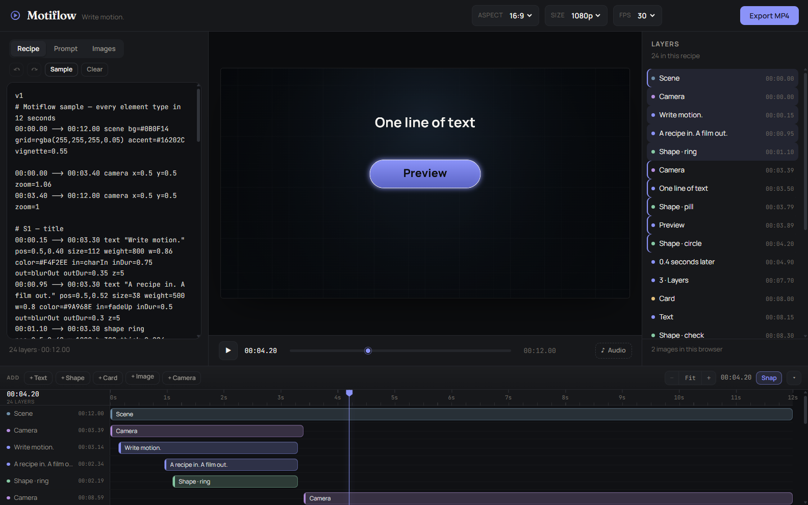
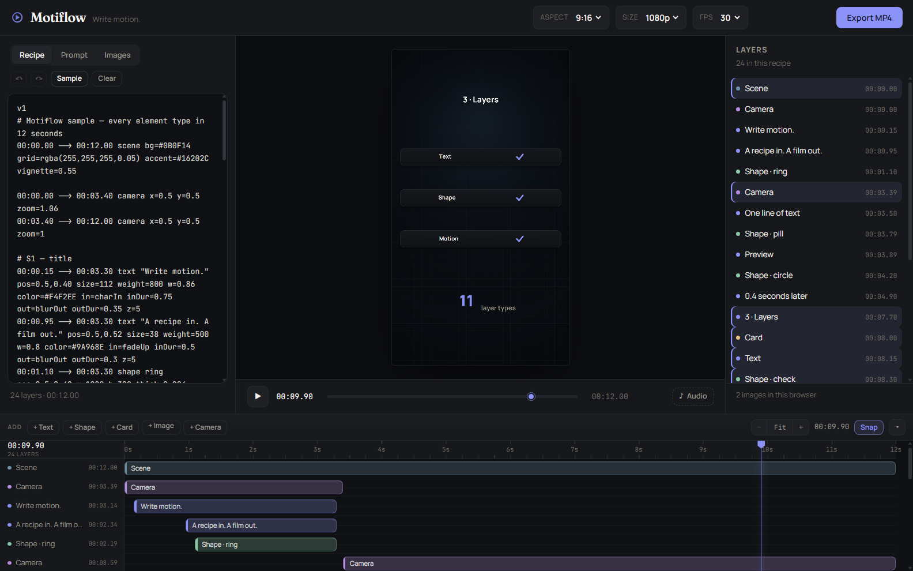

<p align="center">
  
</p>

# Motiflow

**Write motion.**

A motion-graphics studio that runs entirely in your browser. You write (or paste) a short
text recipe, Motiflow renders it live, and you export a clean MP4 — no watermark, no
length cap, no account, no server bill.

[](https://github.com/Zain-developer-ui/Motiflow)
[](https://github.com/Zain-developer-ui/Motiflow)
[](https://github.com/Zain-developer-ui/Motiflow)

| Landscape | Reel |
| --- | --- |
|  |  |

### Why another video tool

Templates give you someone else's taste; editors give you a timeline and a learning curve.
Motiflow gives you a text file. Motion is described in lines that read like a shot list, so
the same recipe renders identically at 720p, 1080p, 16:9 and 9:16, and an AI model can
write one for you. Everything — parsing, drawing, encoding — happens on your machine.

---

## Quick start

```bash
npm install
npm run dev
```

Open <http://localhost:5173>. The sample recipe loads automatically.

```bash
npm run build     # typecheck + production bundle into dist/
npm run preview   # serve the production build
```

The build is a static site — drop `dist/` on any free static host (Cloudflare Pages,
GitHub Pages, Netlify) and it works.

---

## What it does

| | |
| --- | --- |
| Renderer | HTML canvas 2D, text, shapes, cards, images, keyframes, procedural motion, camera |
| Export | H.264 MP4 + AAC audio, 16:9 or 9:16, 720p or 1080p, 30 or 60 fps |
| Cost | zero — encoding happens on the user's machine via WebCodecs |
| Length | unlimited; frames are encoded incrementally, never buffered |
| Watermark | none |
| Accounts | none; nothing leaves the browser |

Images: Motiflow does not generate them. Drop a PNG, JPG, WebP or SVG into the **Images**
tab and the bytes stay in this browser (IndexedDB); the recipe only carries a short
`asset:` handle. Each picture keeps the prompt it was made from, so a shot can be rebuilt
later. Paste that recipe anywhere and the layout still reads — a missing asset draws a
dashed placeholder instead of a broken frame.

### What it does not do

- **No auto transcription.** Paste the script or upload the `.srt` you already have.
- **No image or video generation.** It animates type, shapes and the images you bring.
- **One audio track** for now; multi-track mixing is not in this build.
- **Firefox** previews fine but cannot export (no H.264 in WebCodecs) — Chrome, Edge and
  recent Safari can.

Early build: the recipe format is stable enough to use, but may still gain keys.

---

## The loop

1. **Prompt** — paste a transcript, or drop an `.srt` / `.vtt` and keep its real timings.
   Pick an edit style (**Punch**, **Studio**, **Ink**, **Signal**, **Hook**), type the
   voiceover length, and press **Build prompt**.
2. **Copy** the prompt into ChatGPT, Claude or any model you already use.
3. **Recipe** — paste the `[RECIPE]` block back. It renders immediately.
4. **Edit** — drag anything on the canvas, resize from the corners, retype the words,
   restack, then export.

No API key and no account: the model is whichever chat window you already have open.

The prompt is written like a specification rather than a wish: it fixes the canonical frame
and the unit rule, lists every element and property the renderer actually understands, gives
the timing vocabulary (BUMP, SLAM, NUDGE, BURST, DRAW, STEP), a safe-area table, one full
worked example of the output format, and a final checklist. Without a duration it replies
with `NEED_DURATION` instead of guessing — so the model asks once, you answer with a number,
and every further reply is a complete `[RECIPE]` block with no commentary.

---

## Recipe format

A recipe is a list of timed lines.

```
start --> end <type> [subtype] "text" key=value key=value …
```

- **Time** is `MM:SS.hh` (hundredths of a second).
- **Text** must be wrapped in double quotes and can contain spaces.
- **Comments** start with `#` at the beginning of a line or after a space.
- An optional `v1` line and `[RECIPE] … [/RECIPE]` wrapper are accepted, so a model's
  raw output can be pasted without editing.

```txt
v1
00:00.00 --> 00:12.00 scene bg=#0B0F14 grid=rgba(255,255,255,0.05) vignette=0.55
00:00.15 --> 00:03.30 text "Write motion." pos=0.5,0.40 size=112 weight=800 in=charIn inDur=0.75 out=blurOut
```

### Element types

| Type | Subtype | Draws |
| --- | --- | --- |
| `scene` | — | background fill, grid, accent wash, vignette, stripes |
| `text` | — | wrapped text with per-character, per-word or block animation |
| `card` | — | rounded surface with gradient, border and soft shadow |
| `shape` | `rect` `circle` `pill` `ring` `line` `check` `arrow` | geometry |
| `image` | — | a picture you supplied, with `fit`, rounding, shadow and reveal |
| `camera` | — | zoom / pan applied to every layer while active |

### Sizing rule

Two units, no suffix:

- **`0 … 1`** — a fraction of the canvas **width** (`w=0.86` → 86 % wide, `pos=0.5,0.4`
  → centred horizontally, 40 % down). `w=1.5` deliberately runs past both edges, which is
  how a background bleeds.
- **`> 1`** — pixels authored against the **short side of a 1080 frame** and scaled by
  `min(W, H) / 1080`. `size=112` is 112 px at 1080p, 75 px at 720p, and the same optical
  size on a 9:16 phone as on a 16:9 screen.

That keeps a recipe's composition identical across 720p / 1080p and landscape / portrait.

### Common properties

| Key | Meaning | Default |
| --- | --- | --- |
| `pos=x,y` | centre point, normalised | `0.5,0.5` |
| `z=` | draw order, higher is in front | `0` |
| `w=` `h=` | width / height; for text, `w` is the wrap **and** alignment box | per type |
| `size=` `weight=` `font=` | font size, weight, family (`display` `sans` `mono` `deva`) | `106`, `700`, `sans` |
| `align=` | `left` `center` `right` inside `w` | `center` |
| `anchor=` | `left` `right` `top` `bottom` — `pos` means that edge (shapes only) | centre |
| `color=` | solid colour | white |
| `grad=` `gradr=` | linear (top → bottom) / radial two-stop gradient | — |
| `radius=` | corner radius | `0` |
| `stroke=` `strokeColor=` | outline width and colour | `0` |
| `thick=` | ring / check / arrow thickness | derived from width |
| `shadow=` `glow=` | `0 … 1` softness of the drop shadow / glow | `0` |
| `fit=` | image only — `contain`, `cover` or `fill` | `contain` |
| `bob=` | gentle vertical drift, in frame fractions, for living stills | `0` |
| `reveal=` | wipe the layer in from `left` `right` `up` `down` | — |
| `theme=` | scene palette — `warm` `mint` `lilac` `sand` `night` `paper` | — |
| `wash=` | accent glow strength `0 … 1` | `1` with `accent=`, `0.2` from a theme |
| `texture=` | scene texture — `stripes` | — |
| `textureOpacity=` | strength of that texture | `0.05` |
| `d=` | camera depth `0 … 1` — `0` pins the layer to the frame, `1` follows fully | `1` |
| `emph=` | looping emphasis, `pulse` or `shake`, for the layer's whole life | — |
| `in=` `inDur=` | entrance animation and its duration | `none`, `0.4` |
| `out=` `outDur=` | exit animation and its duration | `none`, `0.3` |
| `id=` | stable name, so another layer can `follow` it | auto |
| `follow=` | `id,edge,offset` — pins this layer to another layer's edge | — |

### Keyframes

```txt
keys=scale:0.50=0.5,0.69=1.12;opacity:0.50=0,0.60=1
```

`prop:time=value,time=value` pairs, separated by `;` for each property. Add `~l` after a
value (`0.69=1.12~l`) to make the segment leading into that keyframe linear; otherwise it
eases in and out. Works with `x`, `y`, `scale`, `opacity`, `rot`.

### Procedural motion

```txt
growTo=w,560,900,1.65,2.40     # animate width 560 → 900 between 1.65s and 2.40s
count=0,2,19.80,20.60          # count a text layer 0 → 2 between 19.80s and 20.60s
count=0,12,9.40,10.20,%        # anything else is appended literally
count=0,3,8.10,8.70,pct        # 3%     inr → ₹4,02,000   group → 402,000
                               # lakh → 4.02L               x → 2x
```

`growTo` on an `anchor=bottom` rect grows a bar up from its base; on an `anchor=left`
line or arrow it draws out of its tail. No keyframes needed.

```txt
00:07.10 --> 00:10.00 shape rect id=barA pos=0.62,0.84 w=0.08 h=0.36 anchor=bottom growTo=h,0.02,0.36,7.10,7.90
00:08.55 --> 00:10.00 text "0" follow=barA,top,-48 count=0,3,8.55,9.05,pct
```

### Animations

Entrance: `fadeUp` `riseIn` `slideL` `slideR` `slideU` `slideD` `scaleIn` `popIn`
`zoomIn` `blurIn` · text only: `charIn` `typeOn` `wordIn` `charFade` · `none`

Exit: `fadeOut` `blurOut` `scaleDown` `popOut` `zoomOut` `slideOutL` `slideOutR` · `none`

Emphasis: `emph=pulse` / `emph=shake` loops for the layer's whole life.

`charIn`, `typeOn`, `wordIn` and `charFade` animate text glyph by glyph; the others treat
the layer as one block.

### Camera

```txt
00:00.00 --> 00:03.40 camera x=0.5 y=0.5 zoom=1.06
00:03.40 --> 00:12.00 camera x=0.5 y=0.5 zoom=1
```

`x`/`y` are the point the camera looks at; `zoom` scales around it. Camera keyframes work
the same way as layer keyframes.

`d=` decides how much of that move each layer feels: background shapes at `d=0.1–0.25`
drift slower than foreground type at `d=1`. That difference is the parallax.

### Images

```txt
00:00.10 --> 00:03.90 image "asset:amvnq6bcl2af1" pos=0.5,0.6 w=0.72 fit=cover radius=28 shadow=0.4
```

The quoted string is either an `asset:<id>` handle (created by **+ Image**) or any URL the
browser is allowed to read. `w` sets the box; `h` is optional, and `fit` decides what happens
when the picture and the box disagree — `contain` letterboxes, `cover` crops, `fill` stretches.
`radius` and `shadow` respect the picture's own alpha, so a cut-out character gets a shadow
around the character, not around its bounding box.

### Reveal and themes

```txt
00:00.00 --> 00:05.00 scene theme=mint texture=stripes textureOpacity=0.05
00:00.00 --> 00:04.80 image "asset:hero" pos=0.5,0.62 w=0.7 reveal=up inDur=1.2
00:00.40 --> 00:04.60 text "Pehle 60 din" pos=0.5,0.2 size=92 reveal=left inDur=0.7
```

`reveal` runs on its own `inDur` clock and clips the layer as it grows in from that edge, so it
composes with any entrance animation. `theme` recolours a section from one word — background
and a soft accent tint — and `texture=stripes` lays a printed-paper pattern over it.

---

## Editing

The preview is not a picture of the recipe — it *is* the recipe. Click any layer to select
it; the selection frame is drawn in the same coordinates the renderer uses, so what you
grab is what moves.

| Action | Effect on the recipe |
| --- | --- |
| Drag a layer | rewrites `pos=`; every selected layer moves together |
| Drag a corner handle | text: `size=` · card/shape/image: `w=` and `h=` |
| Shift-click a layer (canvas, list or timeline) | adds it to the selection |
| Type in the text field | replaces the quoted string |
| X / Y fields | exact `pos=` without hunting with the mouse |
| Stack ↑ / ↓ | rewrites `z=`, one neighbour at a time |
| Delete layer | asks once, then removes every selected line |
| Arrow keys | nudge `pos=` by 0.002 per press (Shift: 0.02) |

### Timeline

The timeline is the real one: a ruler you can scrub, one track per layer, clips laid out in
pixels so zoom, ruler ticks and the playhead always agree.

| Action | Effect on the recipe |
| --- | --- |
| Click / drag the ruler | seeks the playhead; arrow keys nudge it by a frame |
| Drag a clip | moves its `start --> end` window, all selected clips together |
| Drag a clip edge | trims that end; the other end stays put |
| **Snap** (on by default) | cuts land on the playhead, on another cut, or exactly on 0 |
| **− / Fit / +** | zoom 1× → 8×. **Fit** returns to the whole duration |
| **+ Text / Shape / Card / Image / Camera** | inserts a new line at the playhead |
| **▾** | collapses the timeline to its toolbar, for more preview room |

Each clip shows its thumbnail or element colour, its name and a grab handle at both edges.
Snapping shows a thin accent line while a cut is about to land, then disappears — the point
is to make a butt cut exact without reading the timecode.

### Keyframes

The inspector has a row of property chips (**x**, **y**, **scale**, **opacity** — or
**zoom** on a camera). Clicking one adds a keyframe at the playhead for that property, or
removes the key that is already there; a filled chip means "there is a key right here".
Values are sampled at the playhead, so a key holds the pose you see instead of jumping.

Every edit is a rewrite of the source, so the code panel always shows exactly what is on
screen — there is no second copy of the truth to drift. When a layer's position is driven
by `keys=x:…`, dragging it would be a lie, so the inspector says so instead of silently
doing nothing.

### Images

The **Images** tab is the picture side of a recipe, and it answers the two questions the
text cannot: *which* file is behind an `asset:` handle, and *where did it come from*.

- Drop or pick files once; they are stored in this browser and appear in a grid with a
  usage badge (`2×` means two lines point at it).
- Hover a card for **+** to insert it at the playhead, or open it for **Insert at playhead**.
- Each picture has an editable **name** and a **prompt** field — the brief it was made from,
  saved with the bytes. **Copy prompt** puts it back on the clipboard for another run.
- **Delete** removes the bytes; recipe lines that used it keep the handle and the preview
  draws a placeholder, so a recipe never breaks silently.
- The **Prompt an image** builder below turns a subject plus one of five looks (flat
  explainer, paper cut, line art, soft 3D, sticker) into a complete prompt with a fixed warm
  palette. Generate it in any free image tool, then drop the result back in.

The inspector shows the same thing where the shot is edited: when a selected `image` line
carries an `asset:` handle, the panel draws its thumbnail, the handle and how many lines use
it, with a **Replace** button that rewrites the handle in place.

---

## Playback

A playing preview paints the canvas straight from its own animation loop, and the playhead —
timecode, scrubber, timeline marker — lives in a small store outside React state
(`src/lib/playhead.tsx`). That distinction matters on a 24-layer recipe: while the time sat in
component state, every frame re-rendered the editor, the inspector and the whole layer list
before the next frame could be drawn. Now one frame costs one canvas paint plus a fistful of
DOM text updates, and a layer row re-renders only when the playhead crosses its start or end.

While playing, the transport shows the rate the machine is actually reaching (`58 fps`). It is
a measurement, not decoration: if the number drops, the recipe is asking for more than the
browser can draw at that size. Scrub, pause and step stay exact — the store is written on every
seek, so the frozen frame is always the frame the timecode claims.

Text is the expensive part of a frame. Every glyph used to be its own `fillText`, and the
wrap was re-measured on every paint. On the 22-layer sample at 1080×1920 that came to **33.9
glyph calls, 73 `measureText` calls and 8.4 ms of text drawing per frame**. Glyphs that have
finished animating now go out as one run per line, and a line is laid out once per font + wrap
width + string: **2.5 calls, 1.7 measurements, 0.5 ms**. Kerning is off so a batched run lands
exactly where the per-glyph reveal put it — a pixel diff of the old and new builds matches on
four of six sampled frames and differs by seven sub-pixel samples on the other two.

The draw loop also stopped allocating: layer order is sorted once when the scene is built
instead of filter/sort on every frame.

---

## Export

Hit **Export MP4**. Motiflow draws every frame into an offscreen canvas, feeds it to the
browser's hardware H.264 encoder, and muxes the result as it goes. Memory use stays flat,
so a three-minute export is no different from a three-second one.

- **Audio** — attach any file the browser can decode (WAV, MP3, M4A, OGG, FLAC). It is
  resampled to 48 kHz stereo and encoded as AAC alongside the video. Audio is trimmed to
  the video length; if it is shorter, the tail is simply silent. If the browser cannot
  encode AAC, the export still succeeds but says so instead of quietly shipping a silent
  file.
- **Formats** — `avc1` High / Main / Baseline are tried in that order, so an older machine
  still gets a valid file.
- **Filename** — `motiflow-<timestamp>.mp4`.

Measured here: a 10 s 9:16 1080p export is 300 frames and took ~82 s on a laptop, about
0.27 s per frame, producing a 1.9 MB file with both an `avc1` and an `mp4a` track. Length
does not change the memory profile — only the time. The same 12 s 9:16 720p export took 55.3 s
before the text path was batched and 37.0 s after, so export inherits every preview win.

Browsers without WebCodecs (Firefox today) still preview perfectly; the export button
disables itself with an explanation.

Motiflow is desktop-first, but it does not fall apart on a narrow window: the workspace and
the inspector become drawers behind **Script** and **Layers** in the top bar (a scrim closes
them, `Esc` too), the timeline keeps its ruler and clips, and the transport stays one row.
Below ~700 px the frame settings hide — everything else keeps working.

---

## Project layout

```
src/
  App.tsx               studio shell: workspace tabs, canvas editing, layers, timeline, export
  components/
    PromptPanel.tsx     transcript / .srt → prompt builder
    MediaPanel.tsx      images: upload grid, per-image prompt, prompt lab
  lib/
    prompt.ts           style presets, .srt parsing, prompt template
    edit.ts             canvas, timeline and keyframe edits → recipe source rewrites
    assets.ts           IndexedDB image store + decode cache
    playhead.tsx        the playback clock and the controls that read it
    time.ts             mm:ss.cc formatting
  sample.ts             the 12-second demo recipe
  styles.css            design tokens + layout
  engine/
    parse.ts            recipe → layer model, with line-numbered diagnostics
    scene.ts            canvas renderer: text layout, shapes, camera, animation, hit testing
    export.ts           WebCodecs H.264 + AAC → MP4
    easing.ts           easing curves and keyframe evaluation
    paint.ts            colour / gradient helpers
    types.ts            shared types
scripts/
  inspect-mp4.mjs       prints tracks, samples and durations of an MP4
  make-test-audio.mjs   generates a 12 s test WAV
docs/
  example-transcript.srt  a four-cue fixture for the prompt builder
```

---

## Roadmap

- **Shipped** — recipe engine, 16:9 / 9:16 export with audio, prompt builder, canvas
  editing (drag, resize, retype, restack, delete), timeline editing (move, trim, snap,
  multi-select, zoom, collapse), keyframe chips, image layers with IndexedDB assets, an
  image library with prompts and a prompt builder, reveal wipes, scene themes and stripes,
  undo/redo, autosave, drawers on narrow screens.
- **Next — project files.** Autosave keeps one draft in `localStorage`; import/export of
  `.motiflow` files (and a few named projects) is the next step.
- **Later — presets.** Card and checklist presets, karaoke captions, animated counters,
  grain, and a beat grid for cutting to music.

---

## Notes

- `mp4-muxer` still works but is deprecated upstream in favour of
  [Mediabunny](https://mediabunny.dev). The muxing boundary lives in
  `src/engine/export.ts`, so switching is a contained change.
- Work is autosaved in this browser: the recipe and frame settings under
  `motiflow.project.v1`, the prompt draft under `motiflow.prompt.v1`, and image bytes in
  the `motiflow.assets.v1` IndexedDB store. Clearing site data clears all of it, and
  nothing is ever uploaded. Download an export if the project matters — the recipe is the
  only copy.
- Fonts come from Google Fonts (`Fraunces`, `Manrope`, `JetBrains Mono`,
  `Noto Sans Devanagari`). Self-host them before shipping if you want zero third-party
  requests.
- Everything is client-side on purpose: no backend means no hosting cost and no upload of
  anyone's media.
